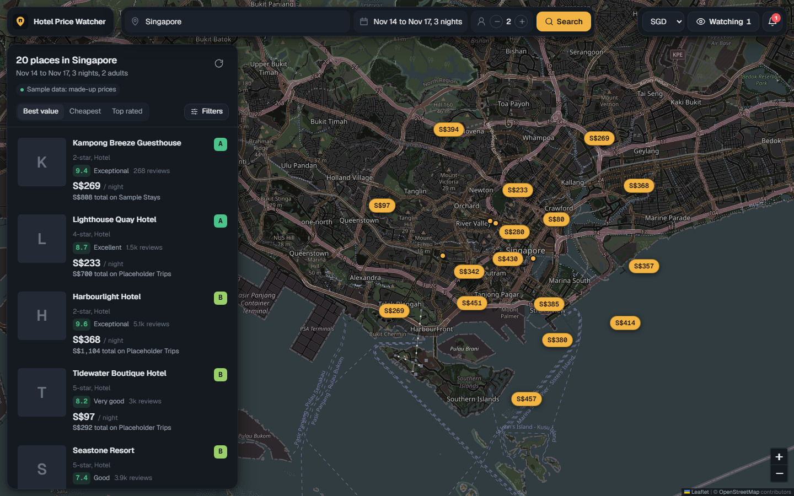
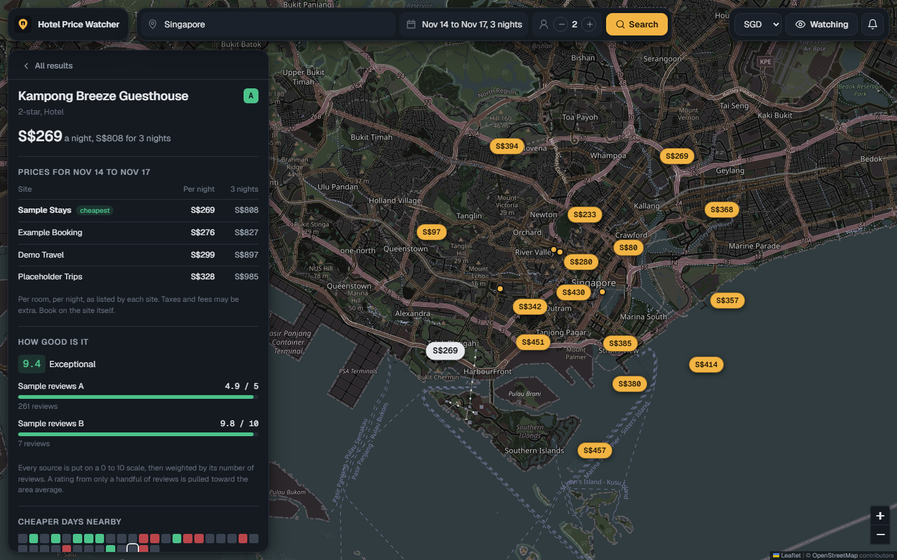
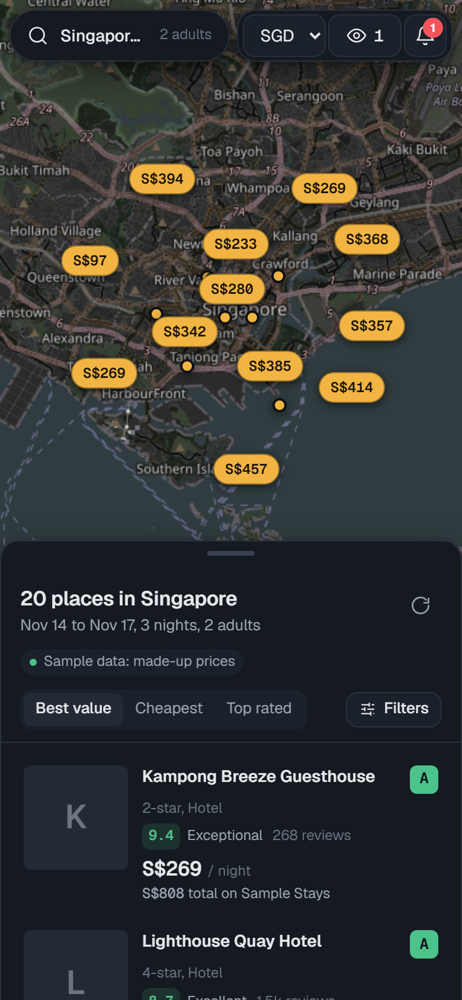

# Hotel Price Watcher

Pick a city and your dates. See every hotel in the area on a dark map, with prices from several booking sites side by side, one quality score built from thousands of reviews, and a value grade that tells you what is actually worth the money there. Then watch the ones you like and get an alert when the price drops.

Self-hosted, free to run, no account needed. Built with FastAPI, React and SQLite.



<p align="center">
  
  
</p>

> Screenshots use the built-in demo data, so the hotel names and prices in them are made up.

## What it does

- **Map-first search.** Every hotel in the area appears as a price pin. Where pins crowd together, the better-value ones keep their label and the rest shrink to dots until you zoom in.
- **Prices for your exact dates** from several booking sites (Booking.com, Agoda, Trip.com, the hotel's own site and others, depending on the hotel). They fill in live as each hotel is checked.
- **One honest quality score (0 to 10).** Ratings from each source are put on the same scale and weighted by how many reviews they come from, so a 5.0 from three reviews can't beat a 4.6 from two thousand. See [docs/scoring.md](docs/scoring.md).
- **A value grade (A to E)** comparing quality against price within the current search. A slider lets you lean toward "cheapest" or "best".
- **Cheaper days nearby.** A small calendar showing which check-in days usually price low for that hotel.
- **Watches and alerts.** Save a hotel for your stay, optionally with a target price. It is re-checked in the background, the history is kept, and an alert appears under the bell when the price hits a new low.
- **Any display currency.** Prices are stored in USD and converted for display with daily ECB rates. The default is SGD.

## Quick start (Docker)

You need Docker with Compose.

```bash
git clone https://github.com/<you>/hotel-price-watcher.git
cd hotel-price-watcher
cp .env.example .env        # optional, every setting has a default
docker compose up --build
```

Open http://localhost:8080. The app only listens on localhost, because it has no login.

To try it with no network calls to hotel APIs at all, set `ENABLED_PROVIDERS=demo` in `.env`.

## Running without Docker

You need Python 3.11+ and Node 20.19+.

```bash
# Backend, on http://127.0.0.1:8000
cd backend
python -m venv .venv
.venv/bin/pip install -e ".[dev]"        # Windows: .venv\Scripts\pip
.venv/bin/python -m hotel_watcher.main

# Frontend, on http://localhost:5173 (proxies /api to the backend)
cd frontend
npm install
npm run dev
```

The backend reads `.env` from the directory you start it in. For the map tile settings in development, put the `VITE_*` lines in `frontend/.env.local`.

## Configuration

All settings are environment variables. `.env.example` lists every one with an explanation. The ones you are most likely to change:

| Variable | Default | What it does |
|---|---|---|
| `ENABLED_PROVIDERS` | `xotelo` | Comma-separated: `xotelo`, `serpapi`, `demo` |
| `SERPAPI_KEY` | empty | Turns on Google Hotels results through SerpApi |
| `SERPAPI_MONTHLY_BUDGET` | `200` | Hard cap on SerpApi calls per month |
| `DEFAULT_DISPLAY_CURRENCY` | `SGD` | First currency the UI shows. Users can switch. |
| `CHECK_INTERVAL_HOURS` | `6` | How often watched hotels are re-checked |
| `XOTELO_MAX_CONCURRENCY` | `4` | Parallel rate lookups. Keep it low, the API is shared. |
| `VITE_TILE_URL` | OpenStreetMap | Map tiles. See [docs/data-sources.md](docs/data-sources.md). |

## Where the data comes from

| Source | Cost | Used for |
|---|---|---|
| [Xotelo](https://xotelo.com) | Free, no key | Hotel list per city, TripAdvisor rating and review count, live nightly rates from several booking sites, cheap-day calendar |
| [SerpApi Google Hotels](https://serpapi.com/google-hotels-api) | Optional key, small free plan | Google rating and review count, per-site prices, amenities, star class |
| [Frankfurter](https://frankfurter.dev) | Free, no key | Exchange rates for display |
| [OpenStreetMap](https://www.openstreetmap.org) tiles | Free for light use | The map, darkened with a CSS filter |

The app does **not** scrape Booking.com, Agoda, Expedia or Google. Their terms forbid it, they block bots aggressively, and it would make this repo a liability for anyone who forks it. Every source above is a public API used within its terms. More detail, including the limits of each source, is in [docs/data-sources.md](docs/data-sources.md).

### Honest limitations

- **Cities.** Xotelo's free tier needs a TripAdvisor location id, and its place-name search is no longer free. The app ships 54 checked cities and also accepts any TripAdvisor hotels link pasted into the search box (for example `https://www.tripadvisor.com/Hotels-g294265-Singapore-Hotels.html`).
- **Room details.** Free sources don't expose room types or bed setups reliably, so the app shows amenities, star class, photos and per-site prices, and links to the listing for the rest.
- **Prices** are per room per night as each site reports them. Taxes and fees may be extra. Always confirm on the booking site.
- **Google-only hotels** (from SerpApi) can't be watched, because re-checking them would spend your SerpApi searches.
- **Panning the map** filters the results you already have. It doesn't run a new search for the new area.

## How it works

```
Browser (React + Leaflet)
   |  /api
   v
FastAPI
   |-- search orchestrator --> providers in parallel (Xotelo, SerpApi, demo)
   |                            each returns a status, never throws
   |-- matching: merges the same hotel seen by several providers
   |-- scoring: one 0 to 10 quality score per hotel
   |-- rates service + cache --> per-hotel live prices
   |-- SQLite: watches, price history, alerts, API usage
   '-- scheduler (in-process): re-checks watches, writes alerts
```

The value grade is computed in the browser, so the slider reacts instantly. See [docs/architecture.md](docs/architecture.md) for the full picture.

## Tests

```bash
cd backend && pytest                 # unit + integration, fully offline
cd backend && pytest tests/live_smoke  # hits the real Xotelo API, run by hand
cd frontend && npm test
```

CI runs lint, type checks, both test suites, the frontend build and the Docker build on every push.

## Roadmap

- Area watches: "tell me when anything in Shibuya rated 8.5+ drops under S$150"
- Email or Telegram alerts as an option next to the in-app inbox
- More review sources where a free, terms-friendly API exists
- Optional place-name search through RapidAPI for users who have a key

## Contributing

Issues and pull requests are welcome. Read [CONTRIBUTING.md](CONTRIBUTING.md) first, especially the part about data sources.

## License

[MIT](LICENSE). Hotel data belongs to its providers. Check each provider's terms before running this for anyone other than yourself.
